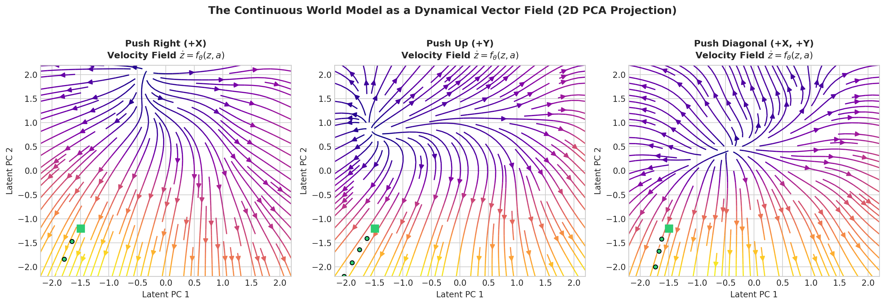
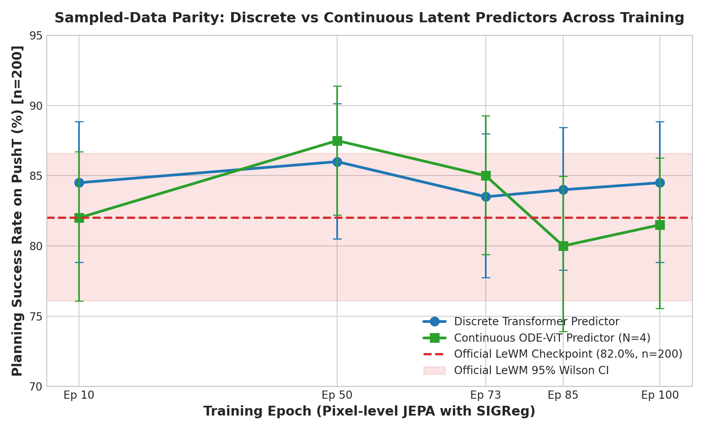
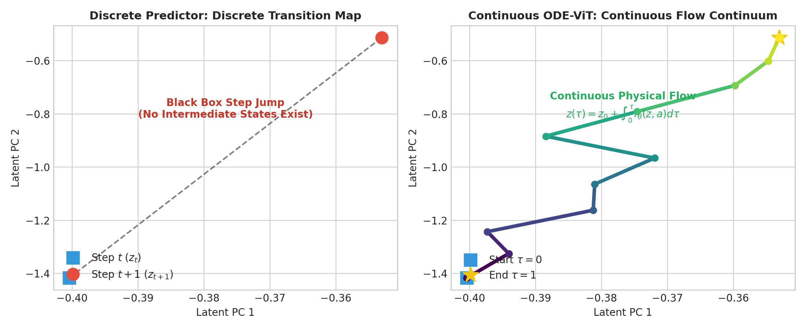

# Continuous-Time LeWM: A World Model Across Any Time Gap

LeWorldModel ([LeWM](https://arxiv.org/abs/2603.19312)) predicts the next latent state in fixed blocks of 5 frames, with the 5 actions of each block lumped into one vector. We replace its transformer predictor with an ODE-ViT, a learned vector field $\dot z = f_\theta(z, a)$, and run it at frame resolution: one action per frame, integrated step by step. The same model can then be asked what the world looks like any number of frames ahead (or behind), including gaps it never saw in training.

<p align="center">
  
</p>

### Key Comparison at a Glance

| Dimension | LeWorldModel (LeWM) | Continuous-Time LeWM (Ours, `fs1_base`) | Matched Discrete Model (`fs1_discrete`) | Takeaway |
| :--- | :---: | :---: | :---: | :--- |
| **Push-T Planning Success\*** | 87.8% | **90.5%** (181/200 episodes) | **90.5%** (181/200 episodes) | Matched-harness parity |
| **Predictor Parameters†** | 10.8M *(18.0M total in ckpt)* | **2.55M** *(8.85M deployed)* | **2.55M** *(8.85M deployed)* | 4.2× fewer predictor params |
| **Observation Context** | 3 frames (history window) | **1 frame (strictly Markovian)** | **1 frame (strictly Markovian)** | Zero history buffering |
| **Dynamics Operator** | Discrete Black-Box Step | **Continuous Field $\dot{z} = f_\theta(z, a)$** | Discrete Step Map | Any horizon $\Delta t$ vs fixed step |
| **Time Reversibility** | No built-in backward operator | **Reversible via $-dt$ integration** | No built-in backward operator | 11% error at 1 frame, 21% at 6 frames |
| **Gradient planning, same predictor, without / with GNC** | — *(not evaluated)* | **19% → 57%** | **19% → 57%** | Velocity mollification ($p \approx 5\times 10^{-22}$) |

*\* Evaluated on the frozen visual encoder harness (200 episodes). On the fully deterministic evaluation harness, official LeWM scores 82.0% and our continuous model scores 85.0%. Across both harnesses, performance differences between continuous, discrete, and baseline LeWM are within statistical parity.*
*† Parameter counts measured directly from checkpoints: official LeWM contains 10,791,360 predictor parameters and 18,042,672 total in `weights.pt`. `fs1_base` and `fs1_discrete` checkpoints contain 2,549,578 parameters (2,253,130 predictor + 296,448 action encoder); deployed total is 8,847,819 when paired with the 6,298,241 parameter frozen visual backbone (encoder + projector).*

---

## Highlights

- **Any time gap, including gaps never seen in training.** We trained on gaps of 1, 2, 3, 5 and 8 frames only, then evaluated on 4, 6, 7, 9, 11 and 15. The ODE predicts them as accurately as the gaps it was trained on (error 0.31 relative to "nothing changes" = 1.0). Composing discrete fixed steps matches this accuracy on integer gaps, while the continuous formulation handles arbitrary horizons natively and composes identically ($\int_0^8 = \int_0^3 + \int_3^8$, defect = 0.0). Trained only on irregular gaps, the ODE still plans at 88% ($n=100$), level with a matched discrete model (89%).
- **Backward in time.** Integrating the vector field backward with $-dt$ reconstructs past latents: about **11% error at one frame back**, **21% at six frames back**. Discrete forward step maps have no built-in backward operator.
- **Graduated non-convexity makes gradient planning work.** Smoothing the learned vector field with noise and annealing the variance to zero lifts gradient-based trajectory planning from **19% to 57%** ($p \approx 5 \times 10^{-22}$), on both continuous and discrete predictors. An ensemble Kalman planner follows the same smoothed gradients from forward rollouts alone and reaches **58.5%** with no backpropagation.
- **One Euler step is enough.** On the model with 5-frame blocks, the field is nearly straight within a step (arc/chord ratio = 1.005), so planning success is identical from 1 to 16 integration steps. At inference, that model costs one velocity evaluation per step.
- **Trains end-to-end from pixels.** Swapped into LeWM's official training recipe as a minimal change, the ODE predictor trains stably from scratch with no representation collapse and matches the transformer at every checkpoint from epoch 10 to 100 ($n=200$ paired).
- **Reduced CEM budget on macro-step models.** On models operating with 5-frame action blocks, evaluating 2,000 CEM rollouts per replan matches LeWM's default 9,000 (85.0% vs 84.5%), giving a ~3× wall-clock speedup per replan at identical success. (For the frame-level model `fs1_base`, sequential step costs are discussed in Limitations below).

<p align="center">
  
</p>

---

## Why Continuous Time

<p align="center">
  
</p>

One vector field serves every horizon, predictions compose exactly, the step size is chosen at inference, and the field is a smooth object that can be integrated backward or smoothed for planning. At a fixed control rate this matches a discrete model's accuracy, which is expected: a flow held over one control step is itself a transition map. Where time is uneven, the continuous formulation takes any gap natively. A model that composes fixed steps generalizes to unseen integer gaps similarly, so the clearest advantages are non-integer steps, backward integration and the smoothing used in planning.

---

## How It Works

- **Frame-level actions.** Each raw 2-D action drives one frame of integration, so the model always knows which action applies when. LeWM's 10-D lumped block is replaced by five ordered steps.
- **Segment-aligned integration.** Actions change at frame boundaries, so each frame is integrated separately and the state carries over continuously. This keeps the solver accurate across action changes.
- **Random time gaps in training.** Each batch samples a gap (1 to 25 frames) and supervises the prediction against the real latent at that frame, weighted $1/\sqrt{\Delta}$. One field has to explain every horizon, which is what lets it generalize to new gaps.
- **Randomized solver steps.** The number of Euler sub-steps varies during training, so the field does not depend on a particular step size.
- **Multi-step rollouts.** Supervising multi-step rollouts instead of single steps was the largest single improvement (20% to 74% at the same size, $n=50$).

---

## Other Findings

- **The training recipe matters most.** Multi-step supervision outweighed every architectural choice we tried.
- **The planning cost tracks the pusher.** The encoder captures the full physical state, but latent distance to the goal image follows the pusher more than the block. That likely limits every planner near 85% and points to better costs.
- **Evaluation needs care.** Small unseeded evaluations swung by more than 10 points on the same checkpoint. Headline comparisons use paired episodes and exact McNemar tests, and the end-to-end and budget results use a fully deterministic evaluator.
- **Also explored, without gains:** between-frame prediction, Koopman/DMD analysis, post-hoc latent straightening, control-affine and momentum variants, dropout, a learned planning cost, and rollout-drift regularizers.

---

## Evaluation Protocol

PushT (`swm/PushT-v1`), goal 25 steps ahead, 50-step budget, CEM (300 samples × 30 iterations) unless stated. Both models in a comparison are evaluated on the same episodes. The end-to-end and planning-budget results use a deterministic evaluator with an independent random stream per episode; the frozen-encoder, irregular-gap and graduated-non-convexity results use an earlier paired, seeded harness. The held-out-gap study uses a model trained only on gaps $\{1, 2, 3, 5, 8\}$. Per-episode outcomes are in [`results/`](results/).

---

## Repository Structure

```
cwm/              models (ODE-ViT, discrete predictors), solvers (CEM, collocation, GNC, EKI), analysis
scripts/          training, evaluation, and publication figure generators
results/          per-episode outcomes behind every reported number
assets/figures/   visualizations, phase portraits, and publication figures
```

### Quickstart & Reproduction

```bash
git clone https://github.com/marc-herrero/continuous-lewm.git && cd continuous-lewm
conda env create -f environment.yml && conda activate cwm

# Evaluate continuous ODE predictor
python scripts/evaluate.py --model ode --ckpt <path> --solver cem --episodes 200

# Evaluate matched discrete predictor
python scripts/evaluate.py --model discrete --ckpt <path> --solver cem --episodes 200
```

---

## Limitations and Next Steps

- **Resolution is set by the data:** The model works at the native frame rate and does not predict between frames.
- **The held-out-gap study evaluates prediction accuracy:** Closed-loop planning was run with regularly spaced observations, so planning from irregular observations is untested.
- **Held-out gaps were whole numbers of frames:** Non-integer timestamps and genuinely asynchronous sensors are the natural next test, and the setting where a vector field has the clearest edge.
- **Frame-level rollouts take more sequential steps per plan:** Because `fs1_base` models dynamics at single-frame resolution (1 action per frame) rather than jumping 5 frames in a single lumped forward pass, a 25-step planning horizon requires 25 sequential integration steps instead of 5 macro steps. In our unoptimized Python evaluation loop, this increases planning wall-clock time per episode relative to coarse macro-step models, even though the sampling budget can be safely reduced.
- **PushT has a fixed control rate:** Variable control rates and other tasks are untested.

---

## Acknowledgements

Built on [LeWorldModel](https://arxiv.org/abs/2603.19312) and the `stable-worldmodel` library, with the PushT dataset from DINO-WM. The continuous predictor architecture adapts [ODE-ViT](https://arxiv.org/abs/2511.16501) (Boned Riera, Romero Sanchez & Ramos Terrades, 2025). The planning work draws on randomized smoothing through contact ([Suh, Pang & Tedrake, 2022](https://arxiv.org/abs/2106.03151)) and ensemble Kalman inversion ([Iglesias, Law & Stuart, 2013](https://arxiv.org/abs/1302.6343)). Related work on latent geometry: [Temporal Straightening for Latent Planning](https://arxiv.org/abs/2603.12231).

---

## Citation

```bibtex
@misc{herrero2026continuouslewm,
  title  = {Continuous-Time LeWM: A World Model Across Any Time Gap},
  author = {Herrero, M.},
  year   = {2026},
  note   = {Research project, Computer Vision Center (CVC)},
  url    = {https://github.com/marc-herrero/continuous-lewm}
}

@article{boned2025odevit,
  title   = {ODE-ViT: Plug \& Play Attention Layer from the Generalization of the ViT as an Ordinary Differential Equation},
  author  = {Boned Riera, Carlos and Romero Sanchez, David and Ramos Terrades, Oriol},
  journal = {arXiv preprint arXiv:2511.16501},
  year    = {2025}
}
```

---

## License

[MIT License](LICENSE) — see `LICENSE` for details.
